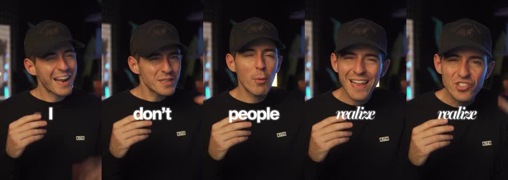

# v05_s04 · face_full_word · 4.3–5.3s (calidad 4)

- **Guion:** And I don't think people realize just
- **Qué se ve:** Punch-in a su cara, sonriendo. Palabras: «And», «I», «don't», «think», «people», «realize» (esta última en serif itálica).
- **Diseño:** Palabra única centrada en x, y≈63 % del alto (sobre el pecho, bajo el mentón), blanca, sans bold ~62 px sobre 720 (≈8 % del ancho por letra alta); la palabra clave cambia a serif itálica de alto contraste (tipo Playfair/Editorial itálica); él ocupa todo el cuadro, ojos en el tercio superior
- **Efectos:** Resplandor blanco suave (glow) detrás de la palabra grande; fondo del set oscuro con luces cian/ámbar desenfocadas; sin grano visible
- **Animación:** Corte seco; palabra a palabra por corte (0,1–0,3 s cada una); «realize» se mantiene ~0,45 s
- **Por qué aquí:** Frase de opinión en primera persona → cara. La itálica marca la palabra que carga la intriga («realize»)
