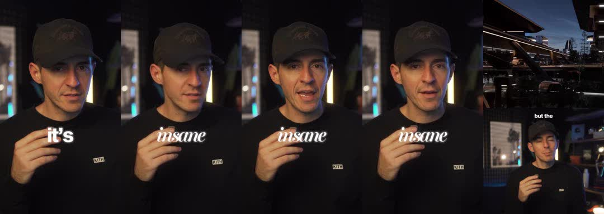

# v05_s11 · face_full_word · 17.7–18.4s (calidad 4)

- **Guion:** It's insane.
- **Qué se ve:** Punch-in: «it's» y luego «insane» en serif itálica.
- **Diseño:** Palabra única centrada en x, y≈63 % del alto (sobre el pecho, bajo el mentón), blanca, sans bold ~62 px sobre 720 (≈8 % del ancho por letra alta); la palabra clave cambia a serif itálica de alto contraste (tipo Playfair/Editorial itálica); él ocupa todo el cuadro, ojos en el tercio superior
- **Efectos:** Resplandor blanco suave (glow) detrás de la palabra grande; fondo del set oscuro con luces cian/ámbar desenfocadas; sin grano visible
- **Animación:** Corte seco; 2 palabras por corte; «insane» ~0,5 s
- **Por qué aquí:** Veredicto emocional de 2 palabras = cara. Repite la promesa del título
