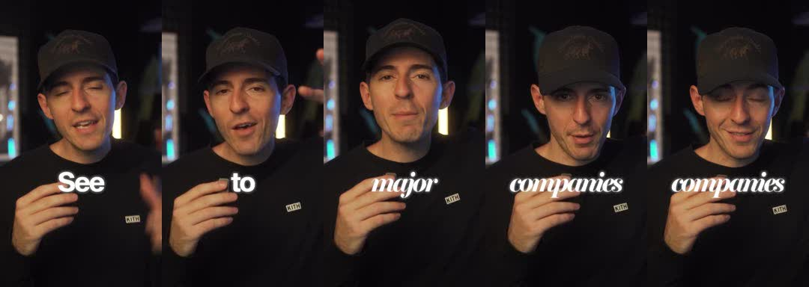

# v05_s15 · face_full_word · 25.8–28.0s (calidad 4)

- **Guion:** See, Elon went to all the major chip companies and
- **Qué se ve:** Punch-in largo: «See», «Elon», «went», «to», «all», «the», «major», «chip» (peso fino), «companies» (serif itálica).
- **Diseño:** Palabra única centrada en x, y≈63 % del alto (sobre el pecho, bajo el mentón), blanca, sans bold ~62 px sobre 720 (≈8 % del ancho por letra alta); la palabra clave cambia a serif itálica de alto contraste (tipo Playfair/Editorial itálica); él ocupa todo el cuadro, ojos en el tercio superior; «chip» aparece en peso light, contraste de pesos dentro de la serie
- **Efectos:** Resplandor blanco suave (glow) detrás de la palabra grande; fondo del set oscuro con luces cian/ámbar desenfocadas; sin grano visible
- **Animación:** Corte seco; 9 palabras una a una por corte (0,15–0,4 s)
- **Por qué aquí:** Empieza la historia («See, Elon went…»): narrar = cara. Es el punch-in más largo (2,2 s)
