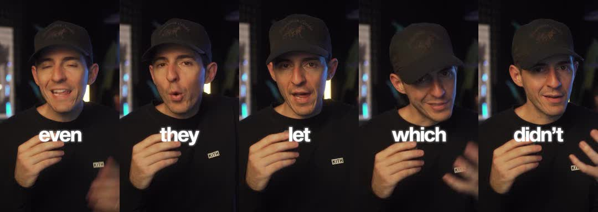

# v05_s17 · face_full_word · 30.0–32.2s (calidad 3)

- **Guion:** And even if they would have let him, which they didn't,
- **Qué se ve:** Punch-in: «And», «even», «if», «they», «would've», «let», «him…», «which», «they», «didn't».
- **Diseño:** Palabra única centrada en x, y≈63 % del alto (sobre el pecho, bajo el mentón), blanca, sans bold ~62 px sobre 720 (≈8 % del ancho por letra alta); la palabra clave cambia a serif itálica de alto contraste (tipo Playfair/Editorial itálica); él ocupa todo el cuadro, ojos en el tercio superior (todo sans bold, con puntos suspensivos en «him…»)
- **Efectos:** Resplandor blanco suave (glow) detrás de la palabra grande; fondo del set oscuro con luces cian/ámbar desenfocadas; sin grano visible
- **Animación:** Corte seco; palabra a palabra por corte
- **Por qué aquí:** Paréntesis con humor («which they didn't»): complicidad con la cara
