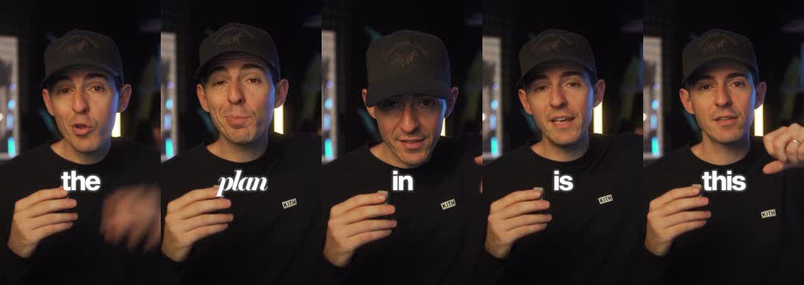

# v05_s34 · face_full_word · 68.3–70.6s (calidad 4)

- **Guion:** So the master plan in summary is this.
- **Qué se ve:** Punch-in: «So», «the», «master» (serif itálica), «plan» (serif itálica), «in», «summary…», «is», «this».
- **Diseño:** Palabra única centrada en x, y≈63 % del alto (sobre el pecho, bajo el mentón), blanca, sans bold ~62 px sobre 720 (≈8 % del ancho por letra alta); la palabra clave cambia a serif itálica de alto contraste (tipo Playfair/Editorial itálica); él ocupa todo el cuadro, ojos en el tercio superior
- **Efectos:** Resplandor blanco suave (glow) detrás de la palabra grande; fondo del set oscuro con luces cian/ámbar desenfocadas; sin grano visible
- **Animación:** Corte seco; palabra a palabra por corte
- **Por qué aquí:** Anuncia el resumen → cara. Las itálicas repiten el concepto «master plan»
