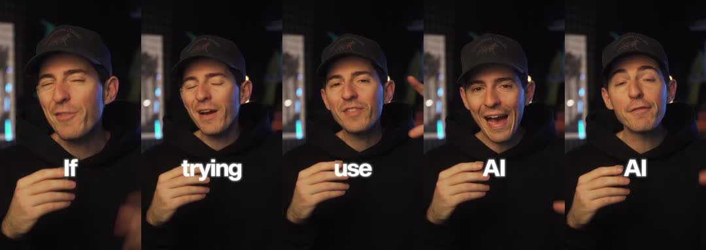

# v06_s02 · face_full_word · 2.6–3.6s (calidad 4)

- **Guion:** If you're trying to use AI for
- **Qué se ve:** Punch-in a su cara: «If», «you're», «trying», «to», «use», «AI», «for».
- **Diseño:** Palabra única blanca sans bold ~62 px con glow, centrada, y≈67 % (sobre el pecho); cara a pantalla completa, ojos en el tercio superior
- **Efectos:** Glow blanco suave tras la palabra; set oscuro con prácticos cian/ámbar desenfocados
- **Animación:** Corte seco; una palabra por corte (0,1–0,3 s)
- **Por qué aquí:** Se dirige al espectador («If you're trying…») → cara: califica a la audiencia
