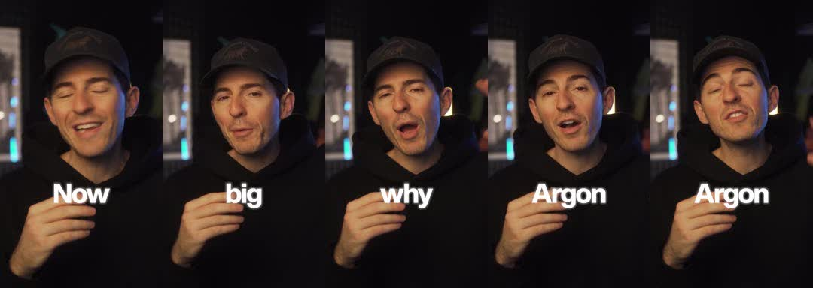

# v06_s10 · face_full_word · 11.2–12.5s (calidad 4)

- **Guion:** Now, big reason why Argonne is
- **Qué se ve:** Punch-in: «Now», «a», «big», «reason», «why», «Argon», «is».
- **Diseño:** Palabra única blanca sans bold ~62 px con glow, centrada, y≈67 % (sobre el pecho); cara a pantalla completa, ojos en el tercio superior
- **Efectos:** Glow blanco suave tras la palabra; set oscuro con prácticos cian/ámbar desenfocados
- **Animación:** Corte seco; palabra por corte
- **Por qué aquí:** Cambio de sección («Now, a big reason why…») → cara
