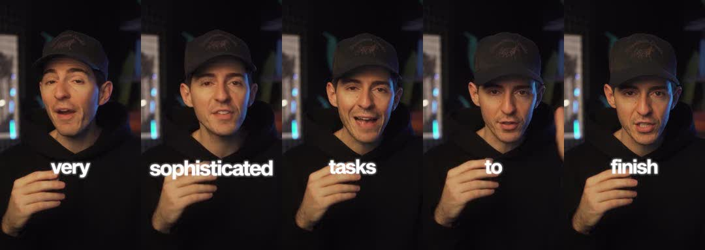

# v06_s15 · face_full_word · 20.5–22.6s (calidad 4)

- **Guion:** sophisticated tasks start to finish without
- **Qué se ve:** Punch-in: «very», «sophisticated», «tasks», «start», «to», «finish».
- **Diseño:** Palabra única blanca sans bold ~62 px con glow, centrada, y≈67 % (sobre el pecho); cara a pantalla completa, ojos en el tercio superior; «sophisticated» ocupa casi todo el ancho (≈88 %)
- **Efectos:** Glow blanco suave tras la palabra; set oscuro con prácticos cian/ámbar desenfocados
- **Animación:** Corte seco; palabra por corte
- **Por qué aquí:** Énfasis en el adjetivo largo: la palabra llena la pantalla
