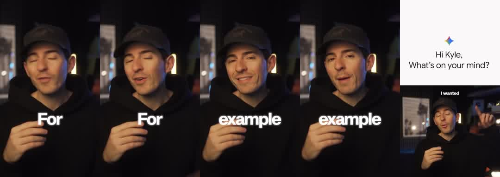

# v06_s17 · face_full_word · 25.1–25.5s (calidad 3)

- **Guion:** For example,
- **Qué se ve:** Punch-in brevísimo: «For», «example».
- **Diseño:** Palabra única blanca sans bold ~62 px con glow, centrada, y≈67 % (sobre el pecho); cara a pantalla completa, ojos en el tercio superior
- **Efectos:** Glow blanco suave tras la palabra; set oscuro con prácticos cian/ámbar desenfocados
- **Animación:** Corte seco; 2 palabras en 0,4 s
- **Por qué aquí:** Bisagra de 0,4 s que anuncia la demo
