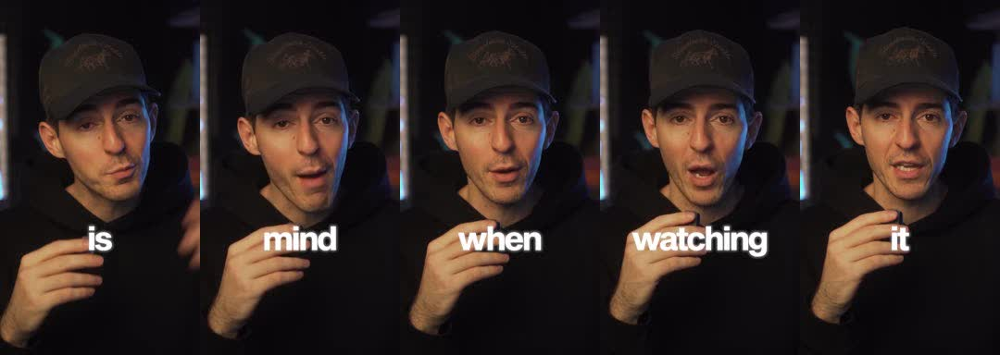

# v06_s29 · face_full_word · 51.5–53.0s (calidad 4)

- **Guion:** pretty mind blowing when you're watching it.
- **Qué se ve:** Punch-in: «is», «pretty», «mind», «blowing», «when», «you're», «watching», «it».
- **Diseño:** Palabra única blanca sans bold ~62 px con glow, centrada, y≈67 % (sobre el pecho); cara a pantalla completa, ojos en el tercio superior
- **Efectos:** Glow blanco suave tras la palabra; set oscuro con prácticos cian/ámbar desenfocados
- **Animación:** Corte seco; palabra por corte
- **Por qué aquí:** Reacción personal («pretty mind blowing») → cara
