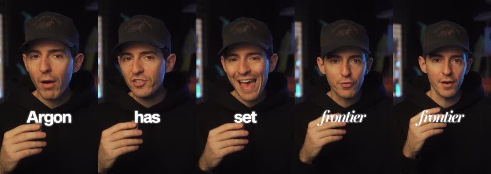

# v06_s41 · face_full_word · 75.9–78.3s (calidad 5)

- **Guion:** Argonne has just set the new frontier.
- **Qué se ve:** Punch-in: «Argon», «has», «just», «set», «the», «new» (serif itálica), «frontier» (serif itálica).
- **Diseño:** Palabra única blanca sans bold ~62 px con glow, centrada, y≈67 % (sobre el pecho); cara a pantalla completa, ojos en el tercio superior; «new» y «frontier» en serif itálica de alto contraste
- **Efectos:** Glow blanco suave tras la palabra; set oscuro con prácticos cian/ámbar desenfocados
- **Animación:** Corte seco; palabra por corte; «frontier» se sostiene ~0,6 s
- **Por qué aquí:** Frase-tesis que repite el título de la franja («new frontier») → cara + itálica
