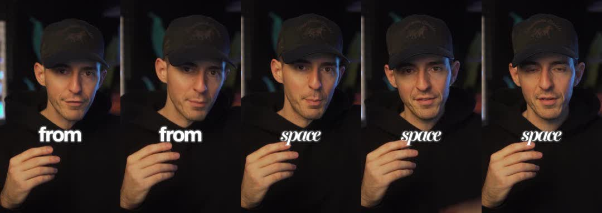

# v07_s05 · face_full_word · 7.4–8.3s (calidad 4)

- **Guion:** space. The
- **Qué se ve:** Punch-in a su cara: «from», «space» (serif itálica).
- **Diseño:** Palabra única blanca sans bold ~62 px con glow, centrada, y≈64 %; la palabra clave en serif itálica de alto contraste; cara a pantalla completa
- **Efectos:** Glow blanco tras la palabra; set oscuro con prácticos cian/ámbar desenfocados
- **Animación:** Corte seco; 2 palabras; «space» se sostiene ~0,5 s
- **Por qué aquí:** Cierra el hook con la palabra que da vértigo («from space») dicha a cámara
