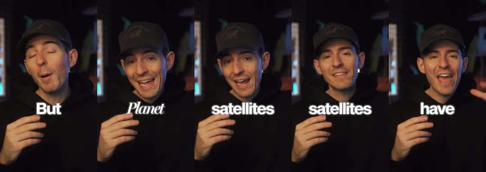

# v07_s12 · face_full_word · 18.8–20.0s (calidad 4)

- **Guion:** But planet satellites have AI
- **Qué se ve:** Punch-in: «But», «Planet», «satellites», «have».
- **Diseño:** Palabra única blanca sans bold ~62 px con glow, centrada, y≈64 %; la palabra clave en serif itálica de alto contraste; cara a pantalla completa (todas en sans bold)
- **Efectos:** Glow blanco tras la palabra; set oscuro con prácticos cian/ámbar desenfocados
- **Animación:** Corte seco; palabra por corte
- **Por qué aquí:** Contraste («But Planet satellites have…») → cara
