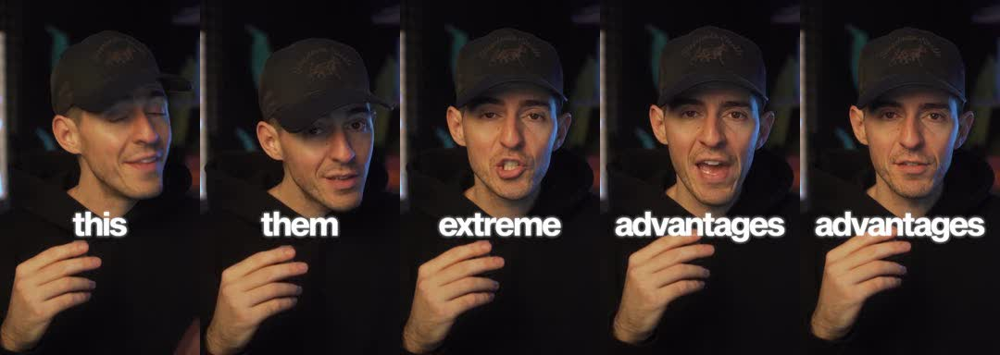

# v07_s16 · face_full_word · 24.6–26.5s (calidad 4)

- **Guion:** And this gives them some extreme advantages.
- **Qué se ve:** Punch-in: «And», «this», «gives», «them», «some», «extreme», «advantages».
- **Diseño:** Palabra única blanca sans bold ~62 px con glow, centrada, y≈64 %; la palabra clave en serif itálica de alto contraste; cara a pantalla completa; «advantages» ocupa ≈85 % del ancho
- **Efectos:** Glow blanco tras la palabra; set oscuro con prácticos cian/ámbar desenfocados
- **Animación:** Corte seco; palabra por corte
- **Por qué aquí:** Bisagra hacia los ejemplos; palabra larga llenando la pantalla
