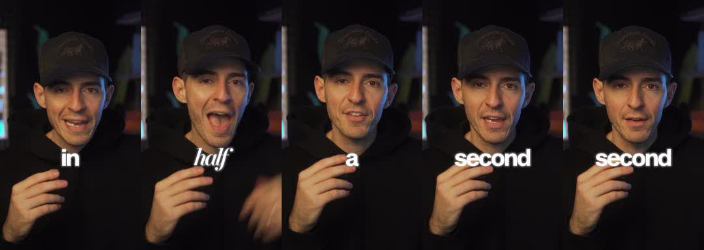

# v07_s20 · face_full_word · 32.4–33.3s (calidad 4)

- **Guion:** half a second.
- **Qué se ve:** Punch-in: «in», «half» (serif itálica), «a», «second».
- **Diseño:** Palabra única blanca sans bold ~62 px con glow, centrada, y≈64 %; la palabra clave en serif itálica de alto contraste; cara a pantalla completa
- **Efectos:** Glow blanco tras la palabra; set oscuro con prácticos cian/ámbar desenfocados
- **Animación:** Corte seco; palabra por corte
- **Por qué aquí:** El dato de velocidad («half a second») se dice a cámara con itálica en «half»
