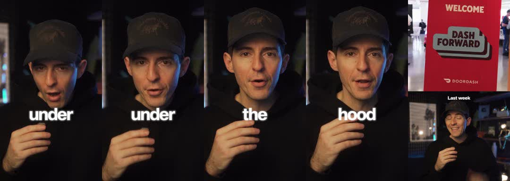

# v08_s03 · face_full_word · 6.6–7.5s (calidad 4)

- **Guion:** the hood.
- **Qué se ve:** Punch-in a su cara: «under», «the», «hood».
- **Diseño:** Palabra única blanca sans bold ~62 px con glow, centrada, y≈66 %; cara a pantalla completa (todas en sans bold)
- **Efectos:** Glow blanco tras la palabra; set oscuro con prácticos cian/ámbar desenfocados
- **Animación:** Corte seco; palabra por corte (0,2–0,4 s)
- **Por qué aquí:** Remate del hook a cámara
