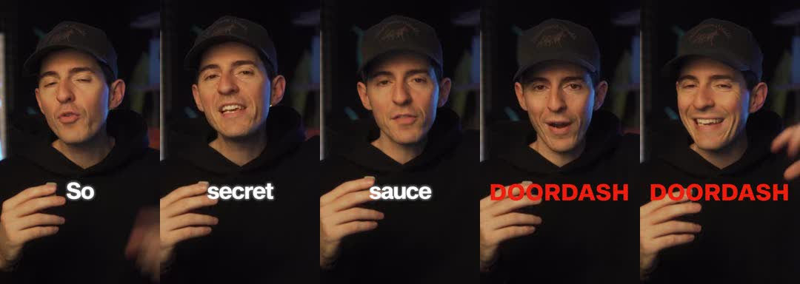

# v08_s22 · face_full_word · 52.8–54.1s (calidad 5)

- **Guion:** So the secret sauce at DoorDash isn't
- **Qué se ve:** Punch-in a Kallaway: «So», «the», «secret», «sauce», «to», «DOORDASH» (esta en rojo y mayúsculas).
- **Diseño:** Palabra única blanca sans bold ~62 px con glow, centrada, y≈66 %; cara a pantalla completa; «DOORDASH» en sans bold MAYÚSCULAS roja (#EB1700 aprox.), ≈85 % del ancho
- **Efectos:** Glow blanco tras la palabra; set oscuro con prácticos cian/ámbar desenfocados
- **Animación:** Corte seco; palabra por corte; «DOORDASH» se sostiene ~0,5 s
- **Por qué aquí:** Vuelve la voz del narrador y resume la cita; la marca en rojo es la única palabra grande con color del video
