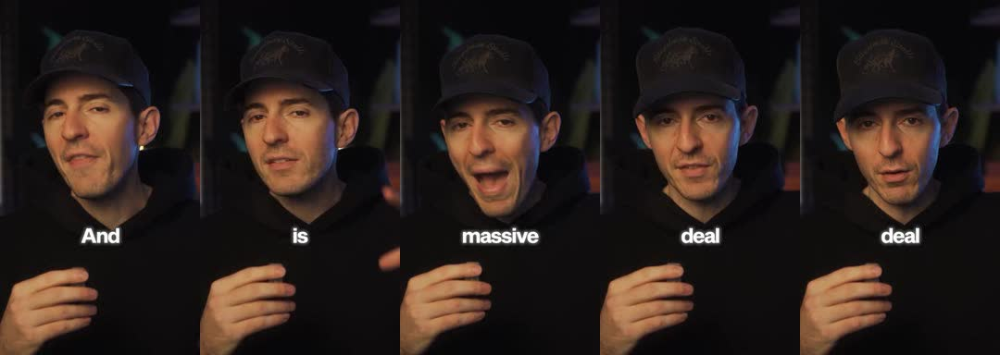

# v10_s02 · face_full_word · 2.2–3.6s (calidad 3)

- **Guion:** this is a massive deal because
- **Qué se ve:** Cara completa con 'And' → 'this' → 'is' → 'a' → 'massive' → 'deal' una a una.
- **Diseño:** Él a pantalla completa en punch-in (cara ≈40–45 % del ancho, ojos en y≈22–25 %). UNA palabra grande centrada en y≈63–67 % (sobre el pecho, bajo la barbilla): sans bold blanca ≈70–80 px de alto de letra en 720 px; la palabra clave en serif itálica de alto contraste (tipo Playfair/Editorial itálica). Sin subtítulo pequeño simultáneo.
- **Efectos:** Sin grano, papel ni halftone añadidos. A-roll: set oscuro, viñeta natural, prácticos cálidos y tubo/luz cian al fondo. Fondo desenfocado (bokeh). La palabra grande lleva un glow/sombra blanca suave alrededor (halo de ≈6–10 px).
- **Animación:** Entra por corte seco (punch-in instantáneo desde el split). Las palabras se sustituyen una a una en el mismo punto, sincronizadas a la voz (≈0.15–0.35 s cada una), sin fade apreciable; sale por corte seco a la siguiente evidencia. Sensación seca y rápida.
- **Por qué aquí:** Importancia declarada mirando a cámara: 'massive deal' necesita cara, no prueba.
