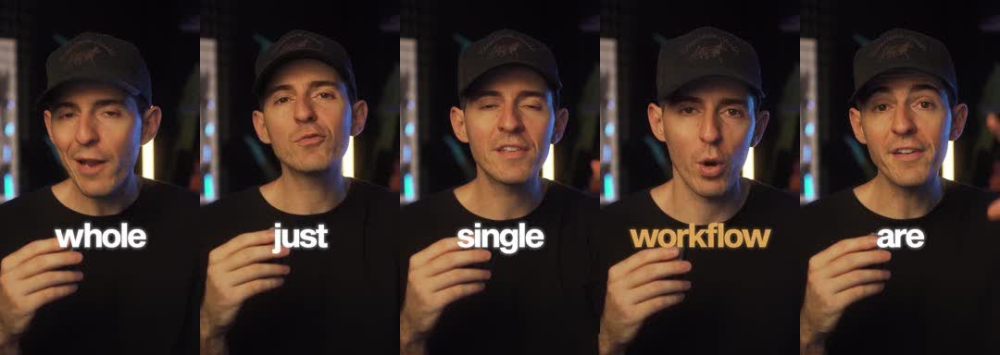

# v13_s34 · face_full_word · 69.7–72.4s (calidad 5)

- **Guion:** Now that whole thing is just one single creator workflow. There are
- **Qué se ve:** Cara a pantalla completa, 13 palabras grandes una a una: «Now that whole thing is just one single creator workflow. There are» — «workflow» en dorado.
- **Diseño:** Punch-in de su cara a pantalla completa (encuadre ojos en tercio superior, barbilla ~45 %). UNA palabra grande cada vez, centrada en x, y≈810 px (63 %), sobre el pecho/mano: sans bold blanca minúsculas ~110 px de alto de fuente (≈4× el subtítulo), con resplandor blanco difuso; palabra clave en dorado (~#E0A93B) o en serif itálica didona (tipo Playfair Display Italic).
- **Efectos:** Glow blanco suave alrededor de la palabra; fondo más oscuro que en el split (viñeta natural del set).
- **Animación:** Cada palabra entra por corte seco al ritmo exacto del habla (0,1–0,5 s por palabra), sin animación de escala visible; la escena entra y sale por corte seco.
- **Por qué aquí:** Re-gancho a mitad de video (minuto 1:10): resume y abre un bucle nuevo («hay docenas más»).
