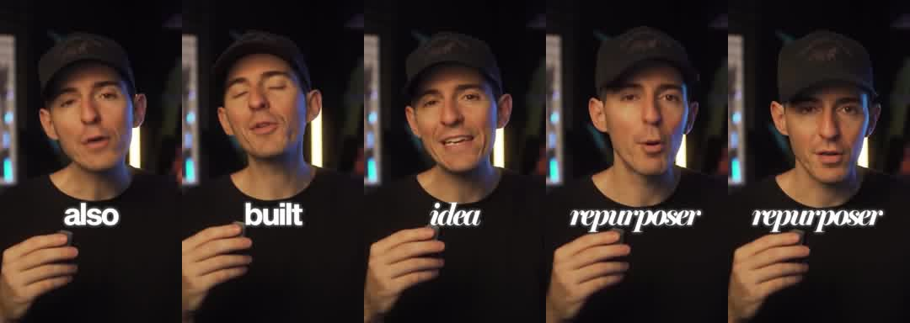

# v13_s39 · face_full_word · 80.3–82.3s (calidad 4)

- **Guion:** I also built an idea repurposer that
- **Qué se ve:** Cara a pantalla completa: «I», «also», «built» (sans) y luego «idea», «repurposer» en serif itálica.
- **Diseño:** Punch-in de su cara a pantalla completa (encuadre ojos en tercio superior, barbilla ~45 %). UNA palabra grande cada vez, centrada en x, y≈810 px (63 %), sobre el pecho/mano: sans bold blanca minúsculas ~110 px de alto de fuente (≈4× el subtítulo), con resplandor blanco difuso; palabra clave en dorado (~#E0A93B) o en serif itálica didona (tipo Playfair Display Italic).
- **Efectos:** Glow blanco suave alrededor de la palabra; fondo más oscuro que en el split (viñeta natural del set).
- **Animación:** Cada palabra entra por corte seco al ritmo exacto del habla (0,1–0,5 s por palabra), sin animación de escala visible; la escena entra y sale por corte seco.
- **Por qué aquí:** Presenta el tercer ejemplo: el nombre del flujo en serif para que se recuerde.
