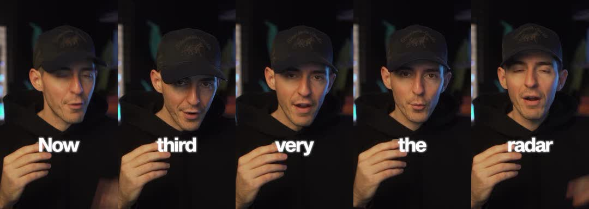

# v14_s30 · face_full_word · 51.5–53.1s (calidad 4)

- **Guion:** Now third and very under the radar is
- **Qué se ve:** Cara a pantalla completa: «Now», «third», «and», «very», «under», «the», «radar», «is».
- **Diseño:** Punch-in de su cara a pantalla completa. UNA palabra grande cada vez, centrada en x, y≈830 px (65 %), sobre la mano/pecho: sans bold blanca minúsculas ~110 px (≈4× el subtítulo) con resplandor blanco difuso. En este video ninguna va en color ni en serif.
- **Efectos:** Glow blanco en la palabra; fondo del set más oscuro.
- **Animación:** Cada palabra entra por corte al ritmo del habla (0,1–0,5 s); la escena entra/sale por corte seco.
- **Por qué aquí:** Separador de capítulo 3.
