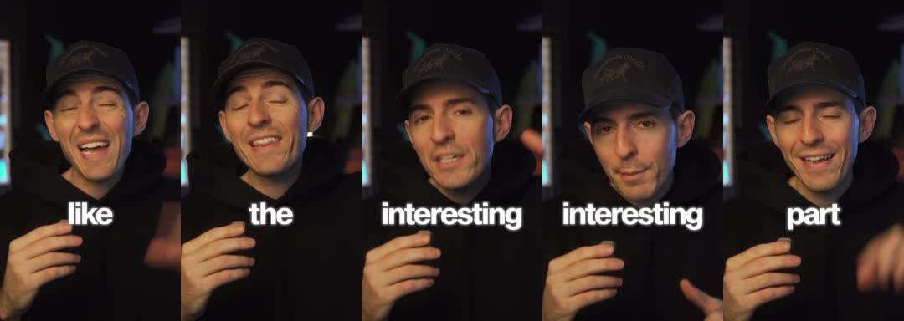

# v14_s54 · face_full_word · 92.0–93.5s (calidad 5)

- **Guion:** Like I said the most interesting part
- **Qué se ve:** Cara a pantalla completa: «But», «like», «I», «said», «the», «most», «interesting», «part».
- **Diseño:** Punch-in de su cara a pantalla completa. UNA palabra grande cada vez, centrada en x, y≈830 px (65 %), sobre la mano/pecho: sans bold blanca minúsculas ~110 px (≈4× el subtítulo) con resplandor blanco difuso. En este video ninguna va en color ni en serif.
- **Efectos:** Glow blanco en la palabra; fondo del set más oscuro.
- **Animación:** Cada palabra entra por corte al ritmo del habla (0,1–0,5 s); la escena entra/sale por corte seco.
- **Por qué aquí:** Re-gancho (minuto 1:32): recupera el bucle abierto en el s 9.
