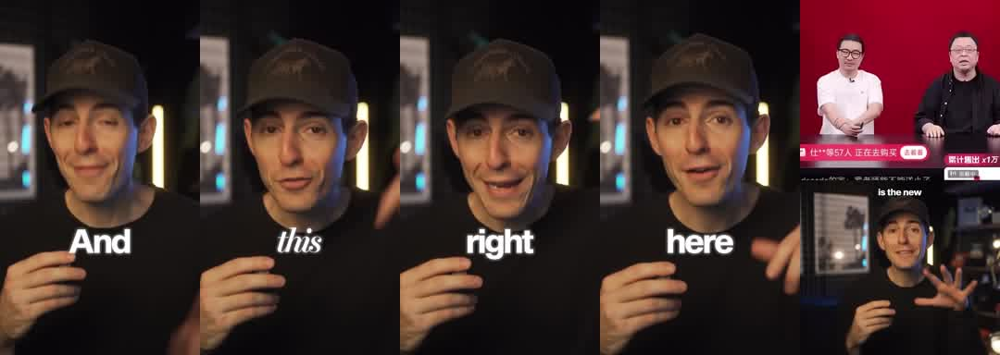

# v15_s11 · face_full_word · 11.8–12.6s (calidad 4)

- **Guion:** And this right here is
- **Qué se ve:** Cara a pantalla completa: «And», «this» (serif itálica), «right», «here».
- **Diseño:** Punch-in de su cara a pantalla completa. UNA palabra grande cada vez, centrada en x, y≈830–900 px (65–70 %): sans bold blanca ~110 px con glow; palabras clave en serif itálica didona (tipo Playfair Display Italic) blanca o en dorado (~#E0B24A).
- **Efectos:** Glow blanco (o dorado) difuso alrededor de la palabra.
- **Animación:** Cada palabra entra por corte al ritmo del habla (0,1–0,5 s); escena entra/sale por corte seco.
- **Por qué aquí:** Señala lo importante antes de la frase-tesis.
