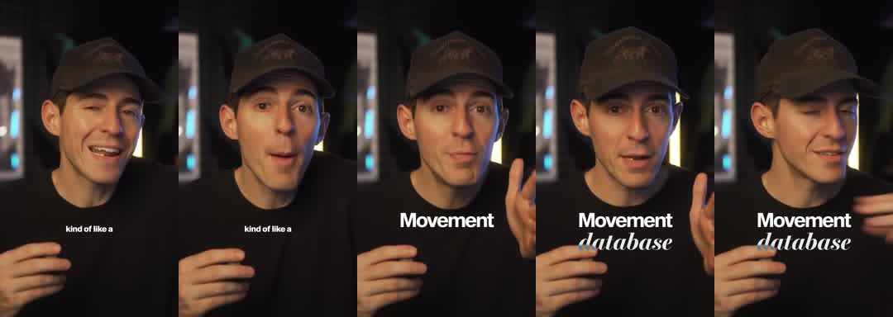

# v15_s27 · face_full_word · 33.6–35.2s (calidad 4)

- **Guion:** Kind of like a movement database that
- **Qué se ve:** Cara a pantalla completa: subtítulo pequeño «kind of like a» y luego rótulo de 2 líneas «Movement» (sans bold blanca) / «database» (serif itálica).
- **Diseño:** Punch-in de su cara a pantalla completa. UNA palabra grande cada vez, centrada en x, y≈830–900 px (65–70 %): sans bold blanca ~110 px con glow; palabras clave en serif itálica didona (tipo Playfair Display Italic) blanca o en dorado (~#E0B24A).
- **Efectos:** Glow blanco (o dorado) difuso alrededor de la palabra.
- **Animación:** Cada palabra entra por corte al ritmo del habla (0,1–0,5 s); escena entra/sale por corte seco.
- **Por qué aquí:** Analogía bautizada («base de datos de movimientos») con sans+serif.
