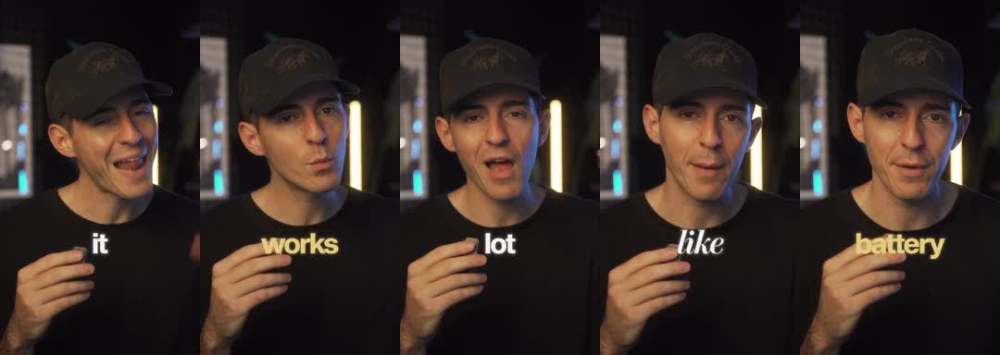

# v16_s37 · face_full_word · 64.3–66.3s (calidad 5)

- **Guion:** But it actually works a lot more like a battery.
- **Qué se ve:** Cara a pantalla completa: «But», «it», «actually», «works» (dorado), «a», «lot», «more», «like» (serif itálica), «a», «battery» (dorado).
- **Diseño:** Punch-in de su cara a pantalla completa. UNA palabra grande cada vez, centrada en x, y≈860 px (67 %): sans bold blanca ~110 px con glow; clave en dorado (~#E0B24A) y/o serif itálica didona (tipo Playfair Display Italic).
- **Efectos:** Glow blanco/dorado difuso en la palabra.
- **Animación:** Cada palabra entra por corte al ritmo del habla (0,1–0,5 s); escena entra/sale por corte seco.
- **Por qué aquí:** Respuesta-sorpresa a la objeción: máximo énfasis tipográfico.
