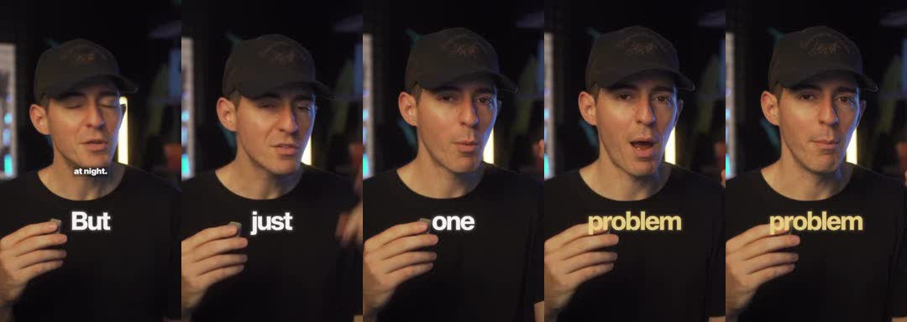

# v16_s41 · face_full_word · 75.0–75.8s (calidad 4)

- **Guion:** But there's just one more problem.
- **Qué se ve:** Cara a pantalla completa: «But», «there's», «just», «one», «more», «problem» (dorado).
- **Diseño:** Punch-in de su cara a pantalla completa. UNA palabra grande cada vez, centrada en x, y≈860 px (67 %): sans bold blanca ~110 px con glow; clave en dorado (~#E0B24A) y/o serif itálica didona (tipo Playfair Display Italic).
- **Efectos:** Glow blanco/dorado difuso en la palabra.
- **Animación:** Cada palabra entra por corte al ritmo del habla (0,1–0,5 s); escena entra/sale por corte seco.
- **Por qué aquí:** Segundo bucle de problema (min 1:15): re-gancho.
