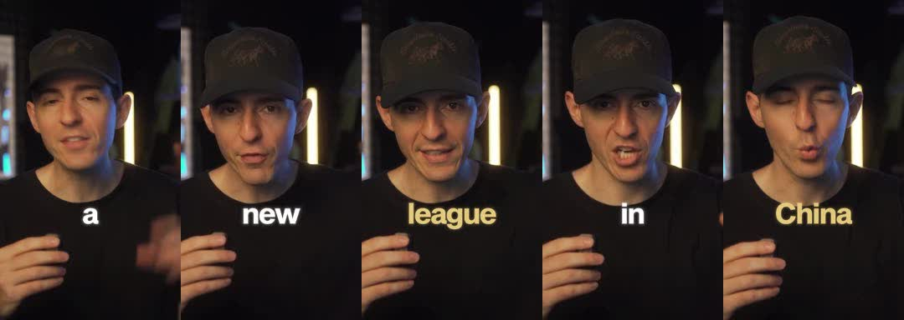

# v18_s03 · face_full_word · 5.7–7.2s (calidad 3)

- **Guion:** It's a new fight league in China where
- **Qué se ve:** Cara completa con palabras grandes una a una: «it's a new fight league in China» («China» en dorado).
- **Diseño:** Su cara a pantalla completa (punch-in ~2x respecto al plano del split, ojos en y≈22–28 %, fondo desenfocado). UNA palabra grande centrada a la altura del pecho (centro y≈67 %): sans geométrica bold blanca en minúsculas, ≈90–100 px de alto de línea, hasta ~75 % del ancho; la palabra clave cambia a serif itálica de alto contraste (tipo Playfair Display Italic).  En este video la palabra clave va en dorado claro ≈#E4C679 (a veces además en serif itálica).
- **Efectos:** Halo/glow blanco suave alrededor de la palabra (resplandor difuso) + sombra; fondo con bokeh; sin grano.
- **Animación:** Corte seco al punch-in; cada palabra reemplaza a la anterior por pop seco (0 fotogramas de transición) exactamente al decirla, ~0.15–0.45 s por palabra; sin movimiento de cámara añadido.
- **Por qué aquí:** Dato de contexto (qué es y dónde) en cara: descanso tras dos planos intensos; el país se destaca en dorado.
