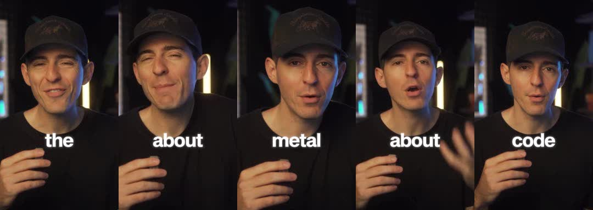

# v18_s13 · face_full_word · 25.2–30.2s (calidad 5)

- **Guion:** the fight isn't really about metal versus metal. It's actually about code versus code.
- **Qué se ve:** Cara completa durante 5 s, 17 palabras una a una: «So the fight(itálica) isn't really about metal versus(itálica dorada) metal. It's actually(dorado) about code versus(itálica dorada) code.»
- **Diseño:** Su cara a pantalla completa (punch-in ~2x respecto al plano del split, ojos en y≈22–28 %, fondo desenfocado). UNA palabra grande centrada a la altura del pecho (centro y≈67 %): sans geométrica bold blanca en minúsculas, ≈90–100 px de alto de línea, hasta ~75 % del ancho; la palabra clave cambia a serif itálica de alto contraste (tipo Playfair Display Italic).  En este video la palabra clave va en dorado claro ≈#E4C679 (a veces además en serif itálica).
- **Efectos:** Halo/glow blanco suave alrededor de la palabra (resplandor difuso) + sombra; fondo con bokeh; sin grano.
- **Animación:** Corte seco al punch-in; cada palabra reemplaza a la anterior por pop seco (0 fotogramas de transición) exactamente al decirla, ~0.15–0.45 s por palabra; sin movimiento de cámara añadido.
- **Por qué aquí:** La tesis del video (no es metal vs metal, es código vs código) se dice entera en cara: la frase más importante no compite con b-roll. «versus» repetido en itálica dorada marca la estructura A vs B.
