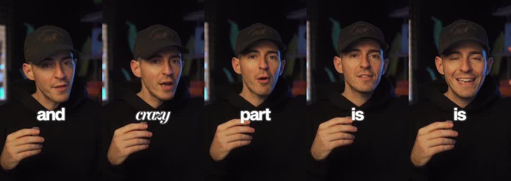

# v19_s07 · face_full_word · 11.3–12.5s (calidad 4)

- **Guion:** And the crazy part is,
- **Qué se ve:** Cara completa palabra a palabra: «And the crazy(serif itálica) part is».
- **Diseño:** Su cara a pantalla completa (punch-in ~2x respecto al plano del split, ojos en y≈22–28 %, fondo desenfocado). UNA palabra grande centrada a la altura del pecho (centro y≈67 %): sans geométrica bold blanca en minúsculas, ≈90–100 px de alto de línea, hasta ~75 % del ancho; la palabra clave cambia a serif itálica de alto contraste (tipo Playfair Display Italic).
- **Efectos:** Halo/glow blanco suave alrededor de la palabra (resplandor difuso) + sombra; fondo con bokeh; sin grano.
- **Animación:** Corte seco al punch-in; cada palabra reemplaza a la anterior por pop seco (0 fotogramas de transición) exactamente al decirla, ~0.15–0.45 s por palabra; sin movimiento de cámara añadido.
- **Por qué aquí:** Frase de reenganche antes del dato NASA: anuncia → cara.
