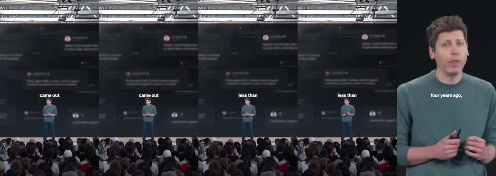

# v01_s38 · full_graphic · 67.2–68.1s (calidad 4)

- **Guion:** out less than
- **Qué se ve:** Video de archivo a pantalla completa: presentador en un escenario con tuits proyectados detrás y público abajo. Subtítulo 'came out' / 'less than'. Sin círculo.
- **Diseño:** Video de archivo a pantalla completa (100 %), SIN círculo con su cara. Subtítulo pequeño blanco sans bold de 2–3 palabras en el centro (y≈54 %), sin pastilla.
- **Efectos:** Sin texturas añadidas.
- **Animación:** Corte seco de entrada y salida; el movimiento es el del propio video.
- **Por qué aquí:** Referencia al lanzamiento de ChatGPT con imagen de archivo.
