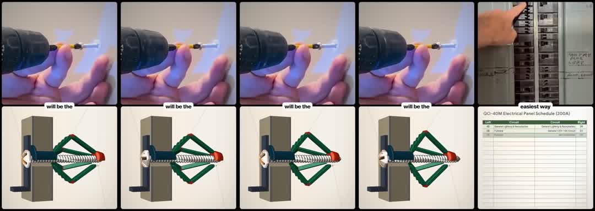

# v02_s35 · full_graphic · 54.7–55.0s (calidad 4)

- **Guion:** be the
- **Qué se ve:** Pantalla completa partida en DOS paneles apilados con esquinas redondeadas: arriba un taladro atornillando, abajo un render 3D de un taco de anclaje. Subtítulo 'will be the' en la unión.
- **Diseño:** Pantalla completa (100 %) sin su cara a cámara ni círculo. Subtítulo pequeño blanco sans bold en el centro (y≈55 %); sobre fondos recargados va dentro de una pastilla blanca con texto negro.
- **Efectos:** Sin texturas añadidas.
- **Animación:** Corte seco de entrada y salida.
- **Por qué aquí:** Ráfaga de 0.3 s: ejemplos de trabajos del mundo real.
