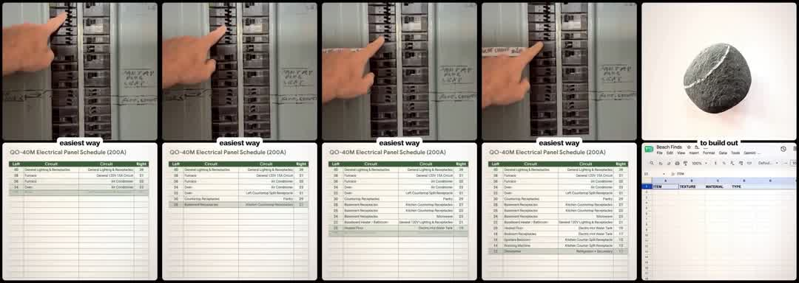

# v02_s36 · full_graphic · 55.0–55.8s (calidad 5)

- **Guion:** easiest way to
- **Qué se ve:** Doble panel: arriba un dedo señalando un cuadro eléctrico, abajo hoja 'QO-40M Electrical Panel Schedule (200A)'. Subtítulo 'easiest way' en pastilla blanca.
- **Diseño:** Pantalla completa (100 %) sin su cara a cámara ni círculo. Subtítulo pequeño blanco sans bold en el centro (y≈55 %); sobre fondos recargados va dentro de una pastilla blanca con texto negro.
- **Efectos:** Sin texturas añadidas.
- **Animación:** Corte seco de entrada y salida.
- **Por qué aquí:** Muestra el patrón 'cosa real → documento' que la función genera.
