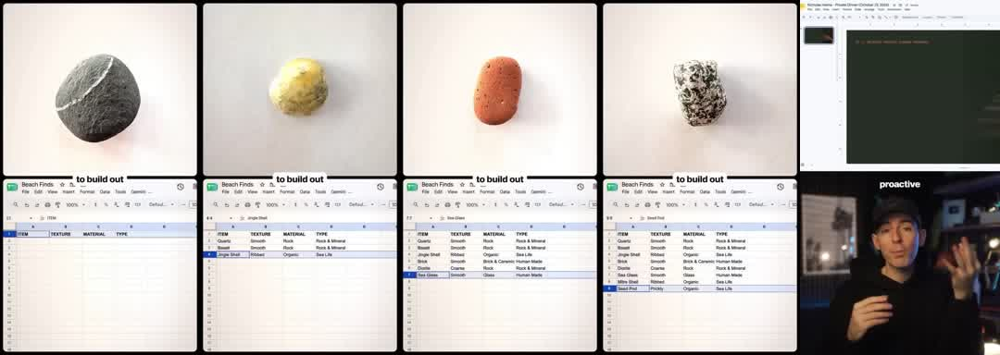

# v02_s37 · full_graphic · 55.8–56.4s (calidad 4)

- **Guion:** build out proactive
- **Qué se ve:** Doble panel: arriba una piedra moteada sobre blanco, abajo hoja 'Beach Finds' con columnas. Subtítulo 'to build out'.
- **Diseño:** Pantalla completa (100 %) sin su cara a cámara ni círculo. Subtítulo pequeño blanco sans bold en el centro (y≈55 %); sobre fondos recargados va dentro de una pastilla blanca con texto negro.
- **Efectos:** Sin texturas añadidas.
- **Animación:** Corte seco de entrada y salida.
- **Por qué aquí:** Tercer ejemplo del mismo patrón.
