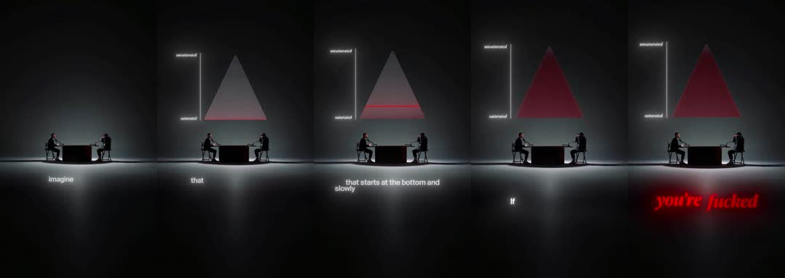

# v03_s03 · full_graphic · 3.7–11.4s (calidad 5)

- **Guion:** imagine there's like a red line that starts at the bottom and like slowly starts rising up that pyramid. If you're below the line, you're fucked because
- **Qué se ve:** Plano general con siluetas; aparece humo que forma una pirámide gris, un eje vertical con 'unsaturated/saturated', y una línea roja que nace en la base y sube tiñendo la pirámide de rojo. Subtítulos: 'imagine there's like a' → 'red line' (rojo) → 'that starts at the bottom and slowly starts rising up that pyramid.' → 'If you're below the line,' → 'you're fucked' (serif itálica roja con glow).
- **Diseño:** Plano general de las dos siluetas (ocupan solo y≈48–56 % del cuadro) con un GRÁFICO superpuesto arriba: triángulo/pirámide gris translúcido (y≈17–43 %), eje vertical blanco a su izquierda con rótulos en serif itálica pequeña 'unsaturated' (arriba) y 'saturated' (abajo), y una línea roja horizontal con glow. Subtítulo acumulativo blanco pequeño bajo la mesa, y≈65–69 %; frase de remate en serif itálica roja con glow.
- **Efectos:** Glow rojo en la línea y en el relleno; pirámide semitransparente con degradado; halo blanco tras las siluetas; negro profundo alrededor.
- **Animación:** La pirámide se forma desde humo/partículas (≈0.3 s), el eje se dibuja de abajo arriba, la línea roja sube y va tiñendo la pirámide de rojo desde la base.
- **Por qué aquí:** Dice 'imagina una línea roja…' y el editor la dibuja literalmente: convierte la metáfora hablada en diagrama.
