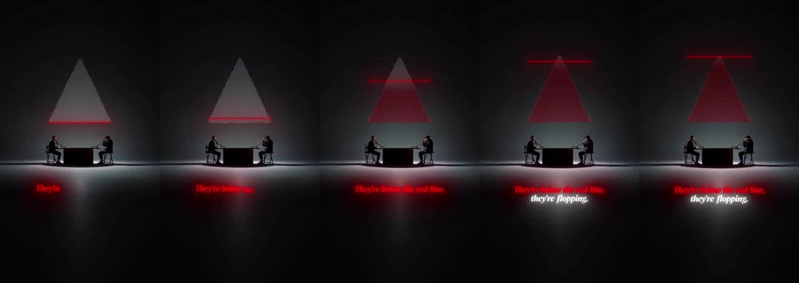

# v03_s07 · full_graphic · 24.6–26.6s (calidad 5)

- **Guion:** below the red line, they're flopping. What
- **Qué se ve:** Vuelve el plano general con la pirámide: la línea roja está cerca de la base y salta hasta quedar por ENCIMA de la punta; la pirámide queda toda roja. Subtítulo 'They're below the red line,' (serif itálica roja) + 'they're flopping.' (serif itálica blanca).
- **Diseño:** Plano general de las dos siluetas (ocupan solo y≈48–56 % del cuadro) con un GRÁFICO superpuesto arriba: triángulo/pirámide gris translúcido (y≈17–43 %), eje vertical blanco a su izquierda con rótulos en serif itálica pequeña 'unsaturated' (arriba) y 'saturated' (abajo), y una línea roja horizontal con glow. Subtítulo acumulativo blanco pequeño bajo la mesa, y≈65–69 %; frase de remate en serif itálica roja con glow.
- **Efectos:** Glow rojo en la línea y en el relleno; pirámide semitransparente con degradado; halo blanco tras las siluetas; negro profundo alrededor.
- **Animación:** La pirámide se forma desde humo/partículas (≈0.3 s), el eje se dibuja de abajo arriba, la línea roja sube y va tiñendo la pirámide de rojo desde la base.
- **Por qué aquí:** Retoma el diagrama justo cuando vuelve a nombrar la línea roja: callback visual.
