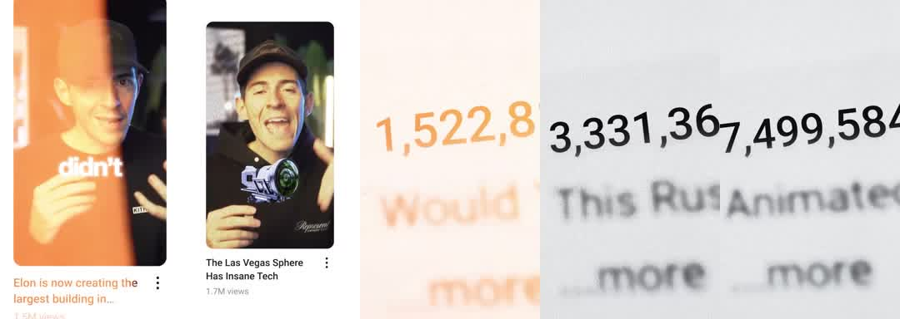

# v04_s06 · full_graphic · 8.6–10.1s (calidad 5)

- **Guion:** billions of views and founder
- **Qué se ve:** Destello naranja/amarillo y cuadrícula de sus Shorts sobre blanco (miniaturas verticales con títulos como 'Would You Buy A 3D Printed House…', 'The Las Vegas Sphere Has Insane Tech', y vistas '1.5M views', '3.2M views') cambiando cada 2–4 fotogramas; termina en un zoom borroso a contadores '1,512,…', '3,202,64…', '4,835,34…', '7,499,58…'.
- **Diseño:** Pantalla completa sin él hablando a cámara: captura, interfaz, logo o b-roll cinematográfico del set. Durante la voz del narrador el subtítulo es distinto: una sola línea sans blanca pequeña (≈18–20 px), sin palabra roja, centrada en y≈66 %.
- **Efectos:** Según el plano: blanco limpio (capturas/logo), azul oscuro (interfaz) o B/N con desenfoque de movimiento (b-roll).
- **Animación:** Entradas con destello de color o fuga de luz de 2–6 fotogramas; dentro, zoom rápido o deslizamiento.
- **Por qué aquí:** 'Miles de millones de vistas' → prueba social en ráfaga de miniaturas y números.
