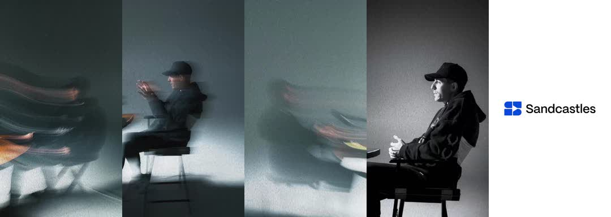

# v04_s07 · full_graphic · 10.1–10.7s (calidad 4)

- **Guion:** of Sandcastles,
- **Qué se ve:** Cuatro planos de 3–4 fotogramas de él en la silla con desenfoque de movimiento tipo larga exposición (tonos gris azulado) y un perfil nítido en B/N. Narrador: 'and founder of'.
- **Diseño:** Pantalla completa sin él hablando a cámara: captura, interfaz, logo o b-roll cinematográfico del set. Durante la voz del narrador el subtítulo es distinto: una sola línea sans blanca pequeña (≈18–20 px), sin palabra roja, centrada en y≈66 %.
- **Efectos:** Según el plano: blanco limpio (capturas/logo), azul oscuro (interfaz) o B/N con desenfoque de movimiento (b-roll).
- **Animación:** Entradas con destello de color o fuga de luz de 2–6 fotogramas; dentro, zoom rápido o deslizamiento.
- **Por qué aquí:** Micro-ráfaga estética para llegar al logo con energía.
