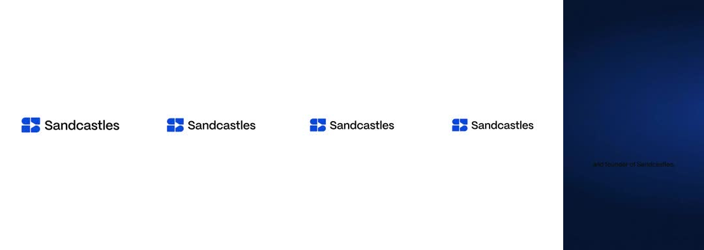

# v04_s08 · full_graphic · 10.7–11.5s (calidad 4)

- **Guion:** a
- **Qué se ve:** Logo 'Sandcastles' (isotipo azul + texto negro) sobre blanco; se reduce de tamaño. Narrador: 'Sandcastles,'.
- **Diseño:** Pantalla completa sin él hablando a cámara: captura, interfaz, logo o b-roll cinematográfico del set. Durante la voz del narrador el subtítulo es distinto: una sola línea sans blanca pequeña (≈18–20 px), sin palabra roja, centrada en y≈66 %.
- **Efectos:** Según el plano: blanco limpio (capturas/logo), azul oscuro (interfaz) o B/N con desenfoque de movimiento (b-roll).
- **Animación:** Entradas con destello de color o fuga de luz de 2–6 fotogramas; dentro, zoom rápido o deslizamiento.
- **Por qué aquí:** Nombre de la empresa → logo, fondo blanco que contrasta con todo lo oscuro.
