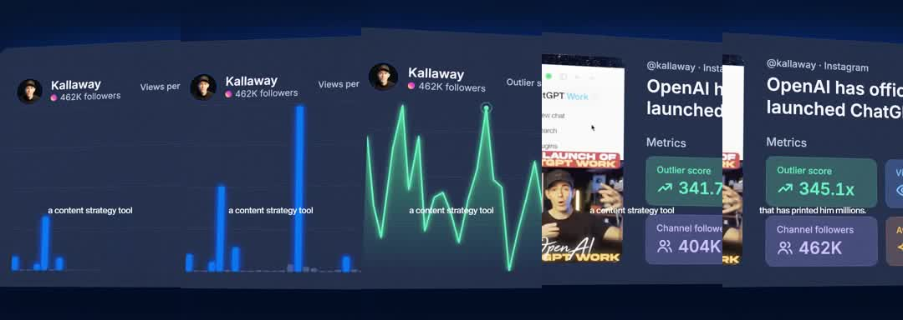

# v04_s09 · full_graphic · 11.5–13.3s (calidad 5)

- **Guion:** content strategy tool that has printed
- **Qué se ve:** Interfaz sobre azul oscuro, en perspectiva: perfil 'Kallaway 462K followers' con gráfico de barras azules, luego línea verde tipo pulso; a 12.60 panel '@kallaway · Instagram — OpenAI has officially launched ChatGPT…', métricas 'Outlier score 345.1x', 'Channel followers 462K' y una miniatura de video. Subtítulo 'a content strategy tool' / 'that has printed him millions.'.
- **Diseño:** Pantalla completa sin él hablando a cámara: captura, interfaz, logo o b-roll cinematográfico del set. Durante la voz del narrador el subtítulo es distinto: una sola línea sans blanca pequeña (≈18–20 px), sin palabra roja, centrada en y≈66 %.
- **Efectos:** Según el plano: blanco limpio (capturas/logo), azul oscuro (interfaz) o B/N con desenfoque de movimiento (b-roll).
- **Animación:** Entradas con destello de color o fuga de luz de 2–6 fotogramas; dentro, zoom rápido o deslizamiento.
- **Por qué aquí:** 'Herramienta de estrategia de contenido' → la herramienta en uso con números grandes.
