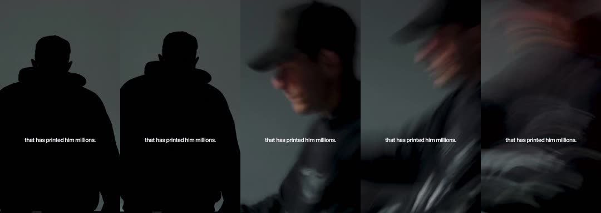

# v04_s10 · full_graphic · 13.3–14.4s (calidad 4)

- **Guion:** him millions.
- **Qué se ve:** Silueta de espaldas muy oscura; fuga de luz naranja que barre (13.60–13.68) y planos borrosos de él con la cabeza baja. Subtítulo 'that has printed him millions.'.
- **Diseño:** Pantalla completa sin él hablando a cámara: captura, interfaz, logo o b-roll cinematográfico del set. Durante la voz del narrador el subtítulo es distinto: una sola línea sans blanca pequeña (≈18–20 px), sin palabra roja, centrada en y≈66 %.
- **Efectos:** Según el plano: blanco limpio (capturas/logo), azul oscuro (interfaz) o B/N con desenfoque de movimiento (b-roll).
- **Animación:** Entradas con destello de color o fuga de luz de 2–6 fotogramas; dentro, zoom rápido o deslizamiento.
- **Por qué aquí:** Cierra la presentación con un plano de 'personaje' y un destello antes de volver a la charla.
