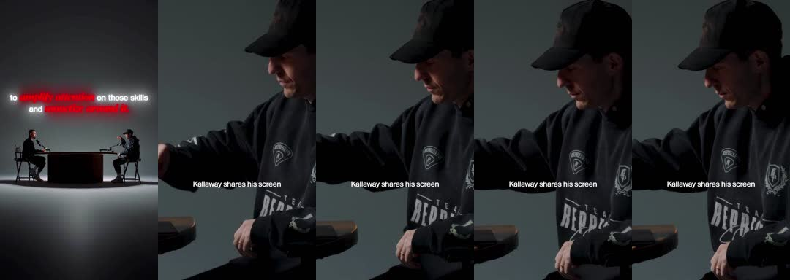

# v04_s15 · full_graphic · 21.7–23.0s (calidad 4)

- **Guion:** Callaway shares his screen
- **Qué se ve:** Destello naranja con banda clara vertical (2 fotogramas) y b-roll en contrapicado de él mirando hacia abajo y moviendo la mano sobre un portátil. Narrador: 'Kallaway shares his screen'.
- **Diseño:** Pantalla completa sin él hablando a cámara: captura, interfaz, logo o b-roll cinematográfico del set. Durante la voz del narrador el subtítulo es distinto: una sola línea sans blanca pequeña (≈18–20 px), sin palabra roja, centrada en y≈66 %.
- **Efectos:** Según el plano: blanco limpio (capturas/logo), azul oscuro (interfaz) o B/N con desenfoque de movimiento (b-roll).
- **Animación:** Entradas con destello de color o fuga de luz de 2–6 fotogramas; dentro, zoom rápido o deslizamiento.
- **Por qué aquí:** El narrador describe la acción → se ve la acción.
