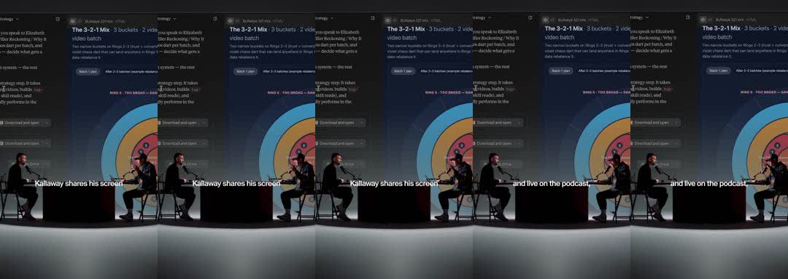

# v04_s16 · full_graphic · 23.0–23.8s (calidad 5)

- **Guion:** and live
- **Qué se ve:** Composición: arriba (≈2/3) un documento/pantalla ('The 3-2-1 Mix · 3 buckets…' con diana de anillos de colores); abajo el plano general de siluetas fundido con la pantalla. Subtítulo 'Kallaway shares his screen' / 'and live on the podcast,'.
- **Diseño:** Pantalla completa sin él hablando a cámara: captura, interfaz, logo o b-roll cinematográfico del set. Durante la voz del narrador el subtítulo es distinto: una sola línea sans blanca pequeña (≈18–20 px), sin palabra roja, centrada en y≈66 %.
- **Efectos:** Según el plano: blanco limpio (capturas/logo), azul oscuro (interfaz) o B/N con desenfoque de movimiento (b-roll).
- **Animación:** Entradas con destello de color o fuga de luz de 2–6 fotogramas; dentro, zoom rápido o deslizamiento.
- **Por qué aquí:** Muestra la pantalla compartida 'encima' de la mesa: une prueba y escena.
