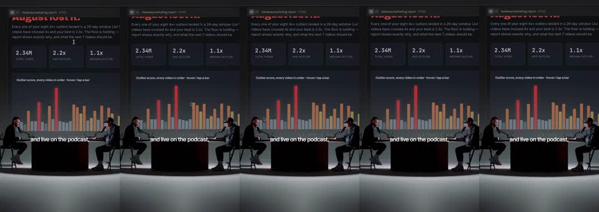

# v04_s18 · full_graphic · 24.8–25.5s (calidad 4)

- **Guion:** built
- **Qué se ve:** Composición: panel de analítica (2.34M, 2.2x, 1.1x y gráfico de barras rojas/naranjas/azules) sobre el plano general de siluetas. Subtítulo 'and live on the podcast,'.
- **Diseño:** Pantalla completa sin él hablando a cámara: captura, interfaz, logo o b-roll cinematográfico del set. Durante la voz del narrador el subtítulo es distinto: una sola línea sans blanca pequeña (≈18–20 px), sin palabra roja, centrada en y≈66 %.
- **Efectos:** Según el plano: blanco limpio (capturas/logo), azul oscuro (interfaz) o B/N con desenfoque de movimiento (b-roll).
- **Animación:** Entradas con destello de color o fuga de luz de 2–6 fotogramas; dentro, zoom rápido o deslizamiento.
- **Por qué aquí:** Otra prueba de lo que construyó en vivo.
