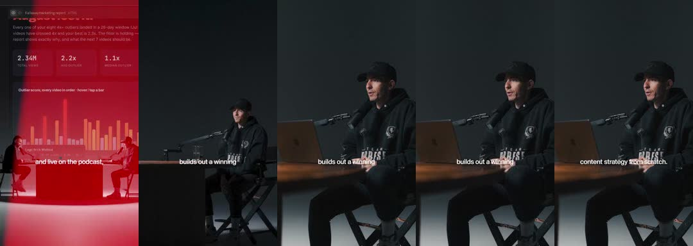

# v04_s19 · full_graphic · 25.5–26.9s (calidad 4)

- **Guion:** out a winning content
- **Qué se ve:** Estrobo amarillo/rojo (≈5 fotogramas) con banda roja vertical que barre; b-roll lateral en B/N de él llevándose algo a la cara (objeto no identificable), luego plano medio lateral. Subtítulo 'builds out a winning'.
- **Diseño:** Pantalla completa sin él hablando a cámara: captura, interfaz, logo o b-roll cinematográfico del set. Durante la voz del narrador el subtítulo es distinto: una sola línea sans blanca pequeña (≈18–20 px), sin palabra roja, centrada en y≈66 %.
- **Efectos:** Según el plano: blanco limpio (capturas/logo), azul oscuro (interfaz) o B/N con desenfoque de movimiento (b-roll).
- **Animación:** Entradas con destello de color o fuga de luz de 2–6 fotogramas; dentro, zoom rápido o deslizamiento.
- **Por qué aquí:** Estrobo para marcar 'builds out'; mantiene el pulso del tráiler.
