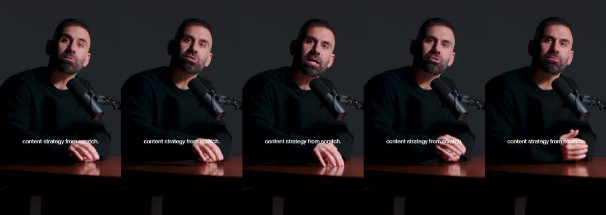

# v04_s21 · full_graphic · 27.8–28.6s (calidad 3)

- **Guion:** scratch. To be
- **Qué se ve:** Primer plano del anfitrión (hombre con barba, auriculares y micrófono) hablando. Subtítulo 'content strategy from scratch.'.
- **Diseño:** Pantalla completa sin él hablando a cámara: captura, interfaz, logo o b-roll cinematográfico del set. Durante la voz del narrador el subtítulo es distinto: una sola línea sans blanca pequeña (≈18–20 px), sin palabra roja, centrada en y≈66 %.
- **Efectos:** Según el plano: blanco limpio (capturas/logo), azul oscuro (interfaz) o B/N con desenfoque de movimiento (b-roll).
- **Animación:** Entradas con destello de color o fuga de luz de 2–6 fotogramas; dentro, zoom rápido o deslizamiento.
- **Por qué aquí:** Presenta al otro interlocutor una sola vez.
