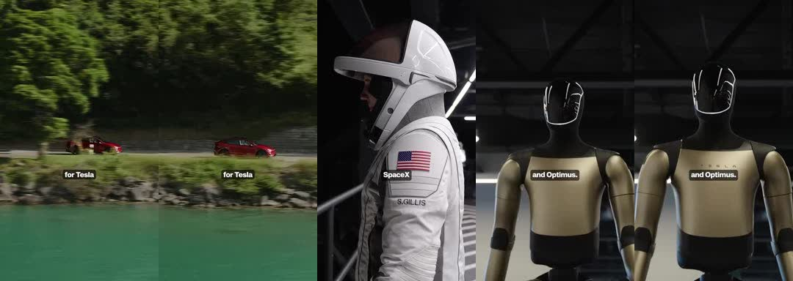

# v05_s19 · full_graphic · 36.8–39.6s (calidad 5)

- **Guion:** Tesla, SpaceX, Grock, and Optimus.
- **Qué se ve:** Cuatro planos a pantalla completa SIN él, uno por empresa: Tesla rojo en carretera (36.83–37.66), astronauta con traje SpaceX (37.66–38.41), pantalla blanca donde se teclea «Grok|» (38.41–38.83), robot Optimus (38.83–39.58). Subtítulo centrado en pastilla: «for Tesla», «SpaceX», «Grok», «and Optimus.».
- **Diseño:** Subtítulo pequeño blanco sans bold dentro de una pastilla gris oscuro semitransparente con esquinas redondeadas (aparece cuando el fondo es claro), centrado, y≈62 %. «Grok» en sans fina negra enorme sobre blanco puro
- **Efectos:** Sin tratamiento común: cada clip conserva su color (verde, B/N, blanco, negro)
- **Animación:** Corte seco exactamente en cada nombre; «Grok» typewriter: G→Gr→Gro→Grok en ~0,3 s
- **Por qué aquí:** Lista de 4 → 4 planos de 0,4–0,8 s: cada nombre tiene su imagen. Quitarle a él de pantalla sube la energía de la enumeración
