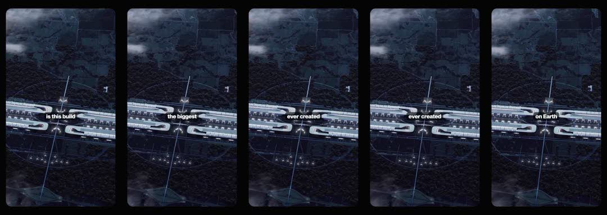

# v05_s35 · full_graphic · 70.6–73.1s (calidad 4)

- **Guion:** Build the biggest building ever created on Earth to
- **Qué se ve:** Tarjeta vertical con esquinas redondeadas sobre negro, sin él: vista cenital nocturna del complejo con un círculo HUD. Subtítulo en el centro de la tarjeta: «is this build», «the biggest», «building», «ever created», «on Earth».
- **Diseño:** Tarjeta que ocupa ≈90 % del ancho y ≈92 % del alto, radio de esquina ≈3 % del ancho, margen negro alrededor. Subtítulo pequeño blanco sans bold dentro de una pastilla gris oscuro semitransparente con esquinas redondeadas (aparece cuando el fondo es claro), centrado, y≈54 %
- **Efectos:** Viñeta negra alrededor de la tarjeta
- **Animación:** Corte seco a la tarjeta (aparece ya en su tamaño); dentro, zoom-out lento
- **Por qué aquí:** Resumen paso 1 de 4: cambia el formato (tarjeta, sin él, sin división) para avisar de que esto es el recap
