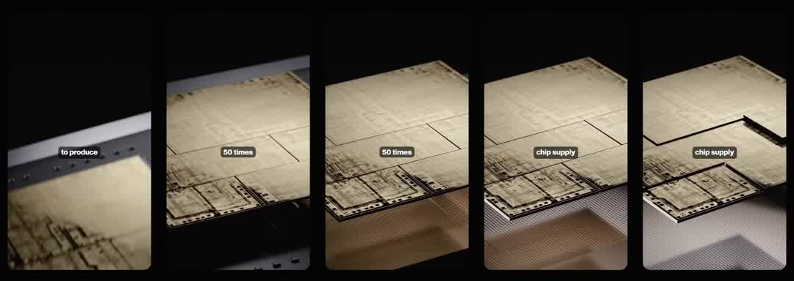

# v05_s36 · full_graphic · 73.1–76.4s (calidad 4)

- **Guion:** produce 50 times the existing chip supply to
- **Qué se ve:** Tarjeta redondeada: macro de un chip/oblea en sepia, la cámara se aleja revelando más superficie. Subtítulos en pastilla: «to produce», «50 times», «the existing», «chip supply».
- **Diseño:** Misma tarjeta redondeada. Subtítulo pequeño blanco sans bold dentro de una pastilla gris oscuro semitransparente con esquinas redondeadas (aparece cuando el fondo es claro), centrado, y≈54 %
- **Efectos:** Tono sepia/dorado, poca profundidad de campo
- **Animación:** Corte seco; el plano empieza desenfocado y cercano y se abre (73.1→73.6)
- **Por qué aquí:** Paso 2: «50 times the existing chip supply» → chip gigantesco
