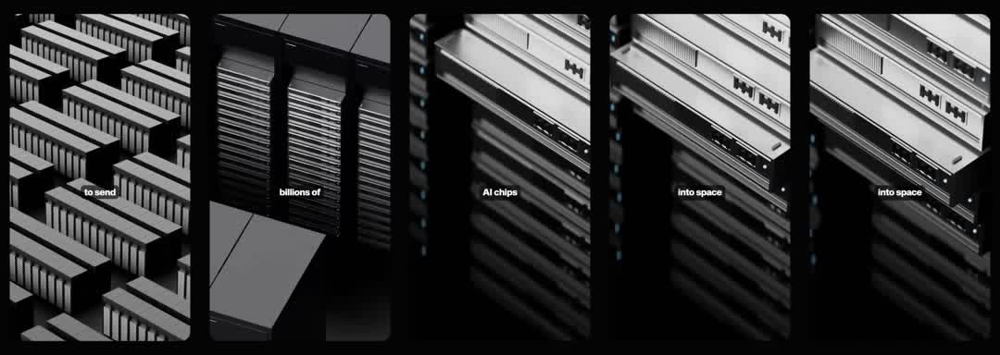

# v05_s37 · full_graphic · 76.4–79.4s (calidad 4)

- **Guion:** send billions of AI chips into space to
- **Qué se ve:** Tarjeta redondeada, 3 renders B/N: filas de racks (76.41–76.95), torres de servidores (76.95–77.79) y primer plano de un rack (77.79–79.41). Subtítulos: «to send», «billions of», «AI chips», «into space».
- **Diseño:** Misma tarjeta redondeada. Subtítulo pequeño blanco sans bold dentro de una pastilla gris oscuro semitransparente con esquinas redondeadas (aparece cuando el fondo es claro), centrado, y≈54 %
- **Efectos:** Render monocromo gris/blanco sobre negro
- **Animación:** Cortes secos en «send», «billions» y «AI»
- **Por qué aquí:** Paso 3: cantidad («billions») → repetición de racks hasta el infinito
