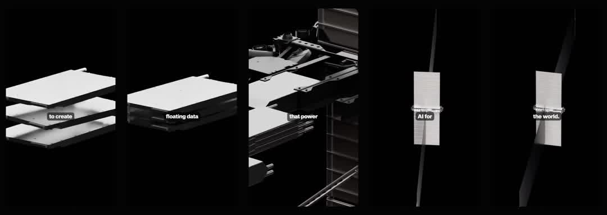

# v05_s38 · full_graphic · 79.4–82.7s (calidad 4)

- **Guion:** create floating data centers that power AI for the world.
- **Qué se ve:** Tarjeta redondeada: losas blancas flotando (79.41–81.04), máquina desplegada (81.04–81.71) y satélite blanco (81.71–82.67). Subtítulos: «to create», «floating data», «centers», «that power», «AI for», «the world.».
- **Diseño:** Misma tarjeta redondeada. Subtítulo pequeño blanco sans bold dentro de una pastilla gris oscuro semitransparente con esquinas redondeadas (aparece cuando el fondo es claro), centrado, y≈54 %
- **Efectos:** Blanco sobre negro
- **Animación:** Cortes secos en «create», «that power» y «AI»
- **Por qué aquí:** Paso 4: cierre del plan reutilizando los renders del satélite (coherencia visual)
